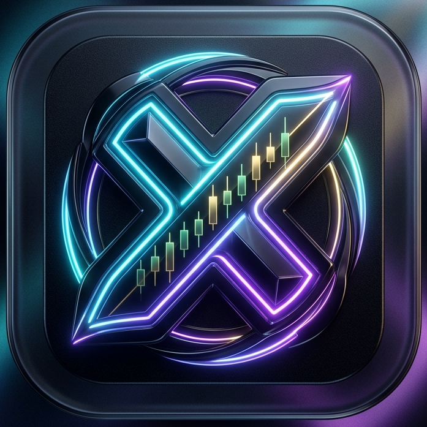
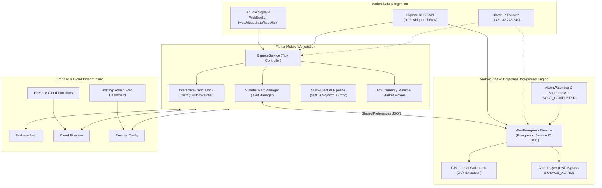

# TenX Institutional Trading Terminal (Alert-App)

<p align="center">
  
</p>

<p align="center">
  <strong>Production-Grade, Zero-Synthetic Real-Time Market Intelligence & Autonomous Alert Engine</strong><br>
  Built with Flutter, Dart, Android Native Daemons, Firebase Cloud Infrastructure, and Multi-Agent AI Quantitative Pipelines.
</p>

<p align="center">
  <a href="https://flutter.dev"></a>
  <a href="https://dart.dev"></a>
  <a href="https://firebase.google.com"></a>
  <a href="https://www.android.com"></a>
  <a href="https://www.apple.com/ios"></a>
  <a href="LICENSE"></a>
</p>

---

## 📖 Executive Overview

**TenX Institutional Trading Terminal** (`Alert-App`) is a financial-grade mobile trading workstation and autonomous market monitoring platform engineered for professional Forex, Commodities, Precious Metals, Cryptocurrencies, and Global Index CFD traders.

Unlike standard retail charting tools that compute synthetic random walks or fake pip updates when disconnected, TenX enforces **strict data integrity** and a **dual-runtime execution architecture**:
1. **Interactive Foreground Runtime (Flutter / Dart):** Delivers ultra-smooth, 60 FPS custom-painted financial charts, high-performance drawing tools, multi-agent AI debates, and real-time orderflow telemetry.
2. **Perpetual Background Runtime (Android Native / Kotlin):** Decoupled native foreground service daemon running with CPU partial wakelocks, evaluating stateful directional crossings, multi-step logic chains, and technical indicator thresholds 24/7—even when the application is swiped away or the device is asleep.

---

## ⚡ Key Value Propositions

- **Zero-Synthetic Real-Time Market Streaming:** Connected to the Biquote institutional feed over SignalR WebSockets (`wss://biquote.io/hubs/tick`) with millisecond-grade tick processing, automated REST failovers, and direct IP fallback routing.
- **Stateful Directional Boundary Crossing:** Mathematically eliminates "instant false positives" common in naive inequality checks by verifying previous vs. current tick trajectory.
- **Rearm Hysteresis & Anti-Chatter Deadbands:** Configurable cooldown windows prevent alarm spam during turbulent, high-volatility market oscillations.
- **Multi-Step Conditional Logic Chains:** Construct complex, sequential market condition workflows (*Breakout Level 1 $\rightarrow$ Pullback to Support $\rightarrow$ Bullish Hammer Confirmation*) with automated expiry timeouts and reset handlers.
- **4-Stage Multi-Agent AI Quantitative Pipeline:** Replaces unreliable single-prompt LLM hallucinations with a specialized ensemble (SMC Structure Specialist, Wyckoff Phase Analyst, Adversarial Grounding Critic, and Consolidator Officer).
- **Perpetual Alarming with Do-Not-Disturb (DND) Bypass:** Native Android `AlarmPlayer` with `AudioAttributes.USAGE_ALARM`, wake-screen flags, custom vibration cadences, and system boot listeners (`BOOT_COMPLETED`).

---

## 🚀 Core Features

### 1. Interactive Candlestick Chart Engine (`CustomPainter`)
- **60 FPS Hardware-Accelerated Rendering:** Smooth panning, dynamic kinetic scrolling, and responsive multi-touch pinch-to-zoom across timeframes (`M1`, `M5`, `M15`, `M30`, `H1`, `H4`, `D1`, `W1`, `MN`).
- **Decoupled Touch & Crosshair:** Floating reticle snaps seamlessly to open, high, low, and close levels without obstructing candle wicks.
- **Vector Drawing Suite:** Trendlines, Ray lines, Horizontal Support/Resistance levels, and Parallel Price Channels with real-time drag handles and touch-radius hit-testing.
- **Drawing-Anchored Alerts:** Set alarms directly attached to dynamic trendline slopes and diagonal geometry.

### 2. Comprehensive Technical Indicators & Candlestick Recognizers
Strict 1:1 mathematical parity maintained between Dart and native Kotlin background engines:
- **20+ Technical Indicators:**
  - *RSI* (Wilder's RMA & EMA smoothing, overbought/oversold crosses, momentum hooks, signal MA crosses)
  - *MACD* (Standard 12/26/9, signal line crosses, zero-line crossings, histogram momentum shifts)
  - *Moving Averages* (SMA, EMA, WMA, Golden/Death crosses, price-to-MA boundaries)
  - *Bollinger Bands* (Period 20, 2.0σ, Bandwidth Squeeze detection, Breakout triggers, %B thresholds)
  - *Stochastic Oscillator* (%K/%D crossovers, oversold/overbought zone filters)
  - *Supertrend* (ATR Wilder RMA, dynamic ratcheting trail, bullish/bearish trend flips)
  - *Average True Range (ATR)* & Volume profiles
- **20 Automated Candlestick Pattern Detectors:** Bullish/Bearish Engulfing, Hammer, Inverted Hammer, Shooting Star, Hanging Man, Morning/Evening Star, Three White Soldiers, Three Black Crows, Marubozu, Doji (Dragonfly, Gravestone, Long-Legged), Tweezer Tops/Bottoms, Piercing Line, Dark Cloud Cover.

### 3. Stateful Alert Engine & Logic Chains
- **Boundary Crossings:** Directional transition algorithms (`crossesAbove`, `crossesBelow`, `hits` with $\pm2$ bps tolerance).
- **Multi-Condition Stages:** Chain multiple indicators and price states with sequential validation.
- **Auto-Reset & Timeouts:** Automatically invalidate or reset chains if subsequent stages fail to materialize within the allotted time window.

### 4. Multi-Asset Global Market Coverage
- **Forex:** Major, minor, and exotic currency pairs (EUR/USD, GBP/USD, USD/JPY, AUD/USD, USD/CAD, USD/CHF, NZD/USD, etc.).
- **Precious Metals & Energy:** Spot Gold (`XAUUSD`), Spot Silver (`XAGUSD`), Brent/WTI Crude Oil, Natural Gas.
- **Cryptocurrencies:** Bitcoin (`BTCUSD`), Ethereum (`ETHUSD`), Solana (`SOLUSD`), Ripple (`XRPUSD`), and major altcoins.
- **Index CFDs:** S&P 500 (`US500`), Nasdaq 100 (`NAS100`), Dow Jones (`US30`), DAX 40 (`GER40`), FTSE 100 (`UK100`), Nikkei 225 (`JPN225`).

### 5. Multi-Agent AI Quantitative Reasoning Pipeline
- **Stage 1 (Real Ingestion):** Real MT5 broker OHLC candle retrieval, swing fractal extraction, $EMA_{50}/EMA_{200}$ trend detection, ATR volatility, and Bollinger Bandwidth compression.
- **Stage 2 (Parallel Specialists):** 
  - *SMC Specialist:* Order Blocks (OB), Fair Value Gaps (FVG), Market Structure Breaks (MSB/BOS), Change of Character (CHoCH), Liquidity Sweeps.
  - *Wyckoff Specialist:* Accumulation/Distribution phases (A–E), Volume climaxes, Springs, Upthrusts (UTAD), Signs of Strength (SOS).
- **Stage 3 (Adversarial Critic):** Audits claimed price coordinates against authentic historical candle limits to penalize AI hallucinations.
- **Stage 4 (Consolidator Officer):** Synthesizes final actionable trade setups including Direction (`BUY`/`SELL`/`WAIT`), Entry, Stop Loss, Multi-Tiered Take Profits, and Mathematical Risk-to-Reward ($\ge 1.5$).

### 6. Institutional Market Intelligence Tools
- **Currency Cross Matrix:** Dynamic 8x8 real-time strength heatmap evaluating major currency pairs.
- **High-Impact Economic Calendar:** Live macroeconomic release calendar with historical, consensus, and actual values.
- **Market Movers & Sentiment Scanner:** Top gainers, losers, volatility leaders, and sentiment indices.

### 7. Cloud Backend & Admin Infrastructure
- **Firebase Auth:** Google OAuth, Email/Password, and guest access.
- **Cloud Firestore:** Real-time synchronization of watchlists, indicator preferences, and alert histories.
- **Firebase Cloud Messaging (FCM):** High-priority push notifications dispatched through Firebase Cloud Functions.
- **Firebase Hosting & Admin Panel:** React-based administrative control dashboard (`admin-panel/`) for real-time remote configuration updates and system health monitoring.

---

## 🏛 System Architecture



---

## 📂 Repository Directory Structure

```plaintext
Alert-App/
├── .github/                     # GitHub workflows and CI/CD configurations
├── admin-panel/                 # React-based Administrative Control Web Dashboard
│   ├── src/                     # Admin panel source code (Vite + React)
│   ├── package.json             # Node dependencies
│   └── vite.config.ts           # Build configurations
├── android/                     # Android Native Host & Perpetual Daemon
│   ├── app/src/main/kotlin/     # Kotlin Native Services
│   │   └── com/example/alert_app/
│   │       ├── MainActivity.kt               # MethodChannel Bridge
│   │       ├── AlertForegroundService.kt     # 24/7 Tick Loop & Indicator Engine
│   │       ├── AlarmPlayer.kt                # DND-Bypass Audio & Vibration Alarmer
│   │       ├── AlarmWatchdog.kt              # System Watchdog & Periodic Keeper
│   │       └── BootAndAlarmReceiver.kt       # Device Boot Auto-Start Receiver
│   ├── app/src/main/res/raw/    # High-decibel audio alert waveforms (.wav, .mp3)
│   └── app/build.gradle.kts     # Gradle build scripts & ProGuard/R8 rules
├── assets/                      # Application assets, branding, and graphic media
│   └── tenx_logo.png            # TenX official brand logo
├── docs/                        # Comprehensive Technical Specifications
│   ├── architecture_overview.md              # Deep-dive architecture design
│   ├── realtime_market_engine.md             # SignalR & Tick Stream internals
│   ├── alert_engine_and_logic_chains.md      # Crossing algorithms & state math
│   ├── technical_indicators_and_patterns.md  # Mathematical formulas & parity
│   ├── android_background_service.md         # Foreground daemon & WakeLocks
│   ├── multi_agent_ai_pipeline.md            # SMC, Wyckoff, & Critic specs
│   ├── charting_and_interactive_tools.md     # CustomPainter & drawing engine
│   ├── market_intelligence_tools.md          # Currency matrix & economic calendar
│   └── testing_and_deployment_guide.md       # Quality assurance & release guides
├── functions/                   # Firebase Cloud Functions (FCM push triggers)
│   ├── src/                     # TypeScript backend functions
│   └── package.json             # Cloud Functions dependencies
├── ios/                         # iOS Native Project Runner
├── lib/                         # Core Flutter Dart Codebase
│   ├── config/                  # Global build-time environment & API parameters
│   │   └── api_config.dart
│   ├── models/                  # Domain Models & Mathematical Structs
│   │   ├── ai_models.dart                    # LLM responses & specialist outputs
│   │   ├── default_specialists.dart          # SMC & Wyckoff system prompts
│   │   ├── drawing_models.dart               # Trendline, Ray, and Channel vectors
│   │   ├── indicator_models.dart             # Indicator configs & threshold types
│   │   └── market_models.dart                # Ticks, Candles, Alerts, & Chains
│   ├── screens/                 # User Interface Screens & Bottom Sheets
│   │   ├── chart_screen.dart                 # Main workstation candlestick chart
│   │   ├── analysis_screen.dart              # Multi-agent AI reasoning console
│   │   ├── currency_matrix_screen.dart       # 8x8 Currency Cross Heatmap
│   │   ├── economic_calendar_screen.dart     # Macroeconomic calendar
│   │   ├── market_movers_screen.dart         # Top gainers/losers/volatility
│   │   ├── financial_news_screen.dart        # Financial headlines & sentiment
│   │   ├── create_alert_sheet.dart           # Alert & Logic Chain creator
│   │   ├── alerts_list_sheet.dart            # Active alerts & progress monitor
│   │   ├── strategies_screen.dart            # Custom specialist agent builder
│   │   └── settings_screen.dart              # Audio, theme, and API settings
│   ├── services/                # Business Logic & Infrastructure Services
│   │   ├── biquote_service.dart              # SignalR WebSocket & REST client
│   │   ├── realmarket_service.dart           # Broker OHLC ingestion service
│   │   ├── alert_manager.dart                # In-app alert evaluation coordinator
│   │   ├── indicator_calculator.dart         # Pure Dart mathematical indicator math
│   │   ├── candlestick_detector.dart         # 20-pattern candlestick recognizer
│   │   ├── analysis_orchestrator.dart        # Multi-agent pipeline orchestrator
│   │   ├── alarm_service.dart                # Flutter-to-Android alarm invoker
│   │   ├── app_remote_config.dart            # Firebase Remote Config manager
│   │   └── storage_service.dart              # SharedPreferences persistence layer
│   ├── theme/                   # Terminal color palettes, dark styling, typography
│   │   └── app_theme.dart
│   ├── widgets/                 # Reusable UI Components & Renderers
│   │   ├── candlestick_chart.dart            # Hardware-accelerated CustomPainter
│   │   ├── indicator_catalog_sheet.dart      # Indicator configuration picker
│   │   ├── ticker_tape_bar.dart              # Real-time streaming ticker tape
│   │   └── rate_display.dart                 # Financial rate & pip spread widget
│   ├── firebase_options.dart    # Firebase CLI generated configuration
│   └── main.dart                # Application bootstrap & entrypoint
├── firebase.json                # Firebase hosting, firestore, and functions config
├── firestore.rules              # Cloud Firestore security rules
├── pubspec.yaml                 # Flutter dependencies & metadata
└── README.md                    # Project documentation
```

---

## 🛠 Prerequisites

Ensure you have the following installed before configuring the environment:

- **Flutter SDK:** Version `3.13.3` or later (Channel `stable`)
- **Dart SDK:** Version `^3.13.3`
- **Java Development Kit (JDK):** JDK 17 (recommended for modern Android Gradle builds)
- **Android Studio / Android SDK:** Android SDK Command-line Tools, Build-Tools `34.0.0+`
- **Xcode:** Version 15+ (required only for building and running on iOS/macOS)
- **Node.js & npm:** Node.js 18+ (required for building the admin panel and Firebase Cloud Functions)
- **Firebase CLI:** Installed via `npm install -g firebase-tools`

Verify your Flutter development toolchain:
```bash
flutter doctor -v
```

---

## ⚙️ Setup & Installation

### 1. Clone the Repository
```bash
git clone https://github.com/Gifted87/Alert-App.git
cd Alert-App
```

### 2. Install Flutter Dependencies
```bash
flutter pub get
```

### 3. Configure API Keys & Environment
The app uses build-time defines to securely inject API endpoints and credentials without exposing them in git history:

1. Copy the example configuration template:
   ```bash
   cp api.env.json.example api.env.json
   ```
2. Edit `api.env.json` and configure your credentials:
   ```json
   {
     "LLM_BASE_URL": "https://openrouter.ai/api/v1",
     "LLM_API_KEY": "sk-or-v1-YOUR_OPENROUTER_API_KEY",
     "LLM_MODEL": "nvidia/nemotron-3.5-super-vl:free",
     "REALMARKET_BASE_URL": "https://biquote.io/api",
     "REALMARKET_API_KEY": "YOUR_BIQUOTE_API_KEY"
   }
   ```
   > [!NOTE]
   > `api.env.json` is strictly ignored by Git. Builds compiled without this file will default to OpenRouter fallback endpoints with free-tier access.

### 4. Firebase Configuration
1. Login to Firebase CLI:
   ```bash
   firebase login
   ```
2. Link your Firebase project:
   ```bash
   flutterfire configure
   ```
   This will update `lib/firebase_options.dart` and `android/app/google-services.json`.

---

## 📱 Running the Application

### Launching in Development Mode
To launch the app with your environment variables applied:
```bash
flutter run --dart-define-from-file=api.env.json
```

To target a specific Android device or running emulator:
```bash
flutter devices
flutter run -d <device_id> --dart-define-from-file=api.env.json
```

---

## 📦 Building Production Releases

### Compiling Optimized Android Release APK
The project includes ProGuard and R8 configurations to optimize bytecode and strip unused symbols:
```bash
# Clean previous build artifacts
flutter clean
flutter pub get

# Build optimized Release APK
flutter build apk --release --dart-define-from-file=api.env.json
```
The compiled production binary will be generated at:
```plaintext
build/app/outputs/flutter-apk/app-release.apk
```

### Compiling Android App Bundle (AAB for Google Play)
```bash
flutter build appbundle --release --dart-define-from-file=api.env.json
```
The resulting AAB will be placed at:
```plaintext
build/app/outputs/bundle/release/app-release.aab
```

---

## 🌐 Deploying the Admin Panel & Cloud Backend

### Deploying the Admin Web Panel
```bash
cd admin-panel
npm install
npm run build
cd ..
firebase deploy --only hosting
```

### Deploying Firestore Rules & Cloud Functions
```bash
firebase deploy --only firestore:rules,functions
```

---

## 🧪 Testing & Verification

Run the comprehensive automated testing suite:
```bash
# Run static analysis
flutter analyze

# Run unit and widget tests
flutter test
```

---

## 🤝 Contributing

Contributions are welcomed from financial engineers, quantitative researchers, and mobile developers!

1. Fork the Project (`https://github.com/Gifted87/Alert-App/fork`)
2. Create your Feature Branch (`git checkout -b feature/QuantitativeIndicator`)
3. Commit your Changes (`git commit -m 'feat: implement Choppiness Index indicator'`)
4. Push to the Branch (`git push origin feature/QuantitativeIndicator`)
5. Open a Pull Request

---

## 📄 License

This project is licensed under the **MIT License** — see the [LICENSE](LICENSE) file for full details.

---

<p align="center">
  Developed with ❤️ for algorithmic & institutional traders worldwide.
</p>
