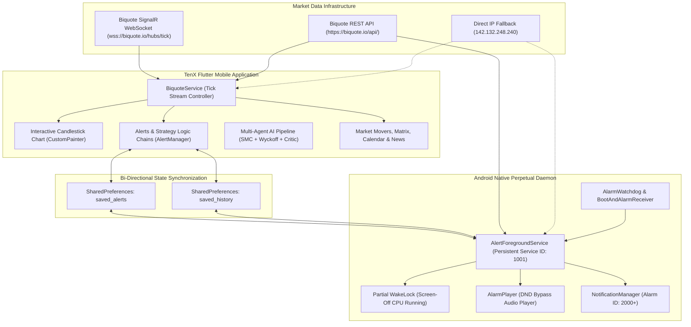

# TenX Institutional Trading Terminal — Documentation Suite

Welcome to the comprehensive technical documentation for the **TenX Institutional Trading Terminal** (`Alert-App`). This repository contains the complete Flutter mobile application, high-frequency Biquote SignalR market data streaming client, multi-agent AI quantitative reasoning pipeline, stateful alerting engine, and native Android perpetual background alarming daemon.

---

## 📚 Documentation Index

| Document | Description | Key Modules |
| :--- | :--- | :--- |
| [**1. System Architecture Overview**](file:///c:/Users/hp/Documents/Web-Projects/Alert-App/docs/architecture_overview.md) | High-level system design, process boundaries, Flutter-Android IPC, and state management. | `main.dart`, `MainActivity.kt`, Architecture Diagrams |
| [**2. Real-Time Market Streaming Engine**](file:///c:/Users/hp/Documents/Web-Projects/Alert-App/docs/realtime_market_engine.md) | Biquote SignalR WebSocket streaming, REST fallback, DNS bypass, and tick aggregation. | `biquote_service.dart`, `realmarket_service.dart` |
| [**3. Alert Engine & Logic Chains**](file:///c:/Users/hp/Documents/Web-Projects/Alert-App/docs/alert_engine_and_logic_chains.md) | Stateful boundary crossings, rearm hysteresis cooldowns, multi-step chains, timeouts, and drawing alerts. | `alert_manager.dart`, `market_models.dart`, `AlertForegroundService.kt` |
| [**4. Technical Indicators & Patterns**](file:///c:/Users/hp/Documents/Web-Projects/Alert-App/docs/technical_indicators_and_patterns.md) | Mathematical formulas, Wilder RMA/EMA smoothing, candlestick pattern rules, and Dart-Kotlin parity. | `indicator_calculator.dart`, `candlestick_detector.dart` |
| [**5. Android Perpetual Background Service**](file:///c:/Users/hp/Documents/Web-Projects/Alert-App/docs/android_background_service.md) | Native foreground service daemon, WakeLocks, DND bypass, alarm players, watchdog, and boot receivers. | `AlertForegroundService.kt`, `AlarmPlayer.kt`, `AlarmWatchdog.kt` |
| [**6. Multi-Agent AI Strategy Pipeline**](file:///c:/Users/hp/Documents/Web-Projects/Alert-App/docs/multi_agent_ai_pipeline.md) | 4-stage quantitative reasoning pipeline: SMC + Wyckoff specialists, Grounding Critic, and Consolidator Officer. | `ai_service.dart`, `analysis_orchestrator.dart`, `ai_models.dart` |
| [**7. Charting & Interactive Drawing Engine**](file:///c:/Users/hp/Documents/Web-Projects/Alert-App/docs/charting_and_interactive_tools.md) | CustomPainter candlestick renderer, 2D viewport math, decoupled crosshair touch gestures, and drawing tools. | `candlestick_chart.dart`, `chart_screen.dart` |
| [**8. Market Intelligence Tools**](file:///c:/Users/hp/Documents/Web-Projects/Alert-App/docs/market_intelligence_tools.md) | Currency Cross Matrix 8x8 heatmap, high-impact Economic Calendar, Market Movers, and News sentiment. | `currency_matrix_screen.dart`, `economic_calendar_screen.dart` |
| [**9. Testing & Deployment Guide**](file:///c:/Users/hp/Documents/Web-Projects/Alert-App/docs/testing_and_deployment_guide.md) | Verification suites, unit tests, release APK compilation, SHA-256 verification, and local downloader server. | `test/`, `flutter build apk`, `tenx-web-downloader` |

---

## 🏛 High-Level System Architecture



---

## 🚀 Quick Reference & Command Cheat Sheet

### Running the Flutter Application
```bash
# Get dependencies
flutter pub get

# Run static code analysis
flutter analyze

# Execute full automated test suite
flutter test

# Run app on connected device / emulator
flutter run
```

### Compiling Production Release APK
```bash
# Clean previous build artifacts
flutter clean
flutter pub get

# Compile optimized release APK with R8 code shrinking
flutter build apk --release

# Built APK location:
# build/app/outputs/flutter-apk/app-release.apk
```

### Serving Web Downloader
```bash
# Start local distribution HTTP server on port 8088
cd tenx-web-downloader
python -m http.server 8088
```
