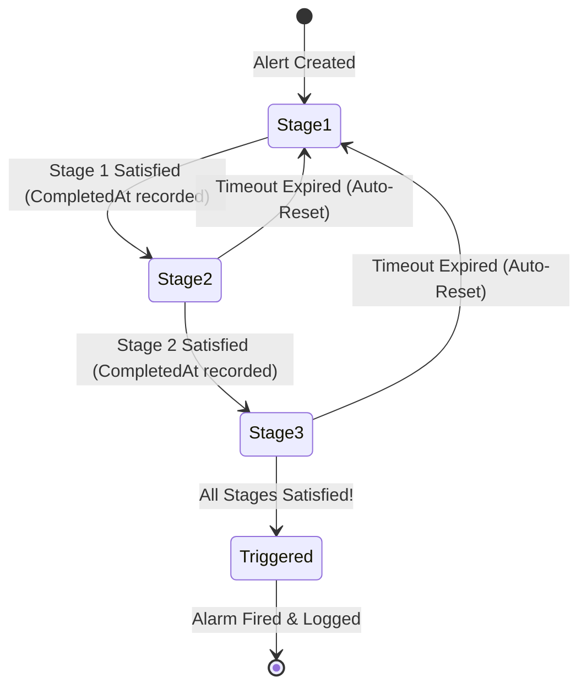

# Alert Engine & Strategy Logic Chains

The TenX alert engine is a financial-grade event processing system capable of evaluating stateful price level crossings, candlestick formations, technical indicator states, and multi-stage conditional strategy chains.

---

## 1. Alert Types & Taxonomy

TenX categorizes alerts into four primary types:

| Alert Type (`AlertType`) | Description | Primary Attributes |
| :--- | :--- | :--- |
| **`priceLevel`** | Single boundary crossing on price action. | `targetPrice`, `condition`, `previousPrice` |
| **`candlestickPattern`** | Confirmation of a 1-to-3 bar Japanese candlestick formation. | `candlestickPattern`, `timeframe`, `triggerOnCandleClose` |
| **`technicalIndicator`** | Threshold crosses, signal line crosses, or flips on indicators. | `indicatorConfig` (`rsi`, `macd`, `maCross`, `bollingerBands`, `stochastic`, `supertrend`) |
| **`multiStepChain`** | Ordered sequence of multi-condition stages requiring sequential satisfaction. | `multiStepConfig` (`stages`, `timeoutMinutes`, `currentStageIndex`) |

---

## 2. Stateful Boundary Crossing Logic

### The "Instant False Positive" Flaw in Naive Alert Systems
Naive alert engines simply evaluate static inequalities on every incoming tick:
$$\text{isTriggered} = P_{curr} \ge Target$$
This causes severe operational errors:
1. If an alert is created when the market is already above the target, it fires immediately on the very first tick.
2. If multi-symbol cloning copies EUR/USD (~1.08) into USD/JPY (~155) or Gold (~2650), the alert immediately screams false alarms.

### TenX Stateful Boundary Crossing Algorithm
TenX enforces strict directional transition across the boundary threshold:

$$\text{Baseline} = P_{prev} \neq \text{null} \ ?\ P_{prev} : P_{initial}$$

* **Crosses Above:**
  $$\text{Trigger} \iff \text{Baseline} < Target \quad \land \quad P_{curr} \ge Target$$
* **Crosses Below:**
  $$\text{Trigger} \iff \text{Baseline} > Target \quad \land \quad P_{curr} \le Target$$
* **Hits Price:**
  $$\text{Trigger} \iff |P_{curr} - Target| \le (Target \times 0.0002) \quad (\pm 2 \text{ bps tolerance})$$

### Continuous State Tracking Through Cooldown
To ensure the engine maintains continuous awareness of market trajectory, $P_{prev}$ is updated to $P_{curr}$ on **every incoming tick**, even during active cooldown deadbands. When cooldown expires, the engine knows whether price has dipped below the boundary and completed a true re-crossing.

Implementation in [market_models.dart](file:///c:/Users/hp/Documents/Web-Projects/Alert-App/lib/models/market_models.dart#L856-L879):
```dart
bool checkTrigger(double currentPrice, {DateTime? now}) {
  if (!isActive || isPatternAlert || isIndicatorAlert || isMultiStepAlert) return false;
  final currentTime = now ?? DateTime.now();
  final baseline = previousPrice ?? initialPrice;
  previousPrice = currentPrice;

  // Cooldown Hysteresis Filter
  if (cooldownMinutes > 0 && lastTriggeredAt != null) {
    if (currentTime.difference(lastTriggeredAt!).inMinutes < cooldownMinutes) {
      return false; // Still within cooldown deadband
    }
  }

  bool isTriggered = false;
  switch (condition) {
    case AlertCondition.crossesAbove:
      isTriggered = baseline < targetPrice && currentPrice >= targetPrice;
      break;
    case AlertCondition.crossesBelow:
      isTriggered = baseline > targetPrice && currentPrice <= targetPrice;
      break;
    case AlertCondition.hits:
      isTriggered = (currentPrice - targetPrice).abs() <= (targetPrice * 0.0002);
      break;
  }
  return isTriggered;
}
```

---

## 3. Rearm Hysteresis & Cooldown

To prevent "alarm chatter" (rapid repeated alarms when price oscillates around a boundary in high-volatility conditions), TenX alerts support customizable cooldown deadbands:
* **`cooldownMinutes = 0` (Single Shot):** The alert rings once and immediately transitions to `isActive = false`.
* **`cooldownMinutes > 0` (Rearmable):** The alert rings, records `lastTriggeredAt = now`, and remains `isActive = true`. For the duration of `cooldownMinutes`, further alarms are suppressed. Once the window expires, the alert re-arms and requires a fresh boundary crossing to fire again.

---

## 4. Multi-Step Logic Chains & Expiry Windows

Multi-step logic chains allow traders to define complex trade setup sequences (e.g., *Breakout Level 1 $\rightarrow$ Pullback to Support $\rightarrow$ Bullish Hammer Confirmation*).



### Chain Structure & Logic Operators
* **`ChainStage`:** Contains a collection of `ChainNode` items connected via `logicOperator` (`AND` / `OR`).
* **`ChainNode`:** Can evaluate a price level, a candlestick pattern, or a technical indicator. Supports `isNegated = true` (NOT operator) to invert the condition.
* **Stage Timeout (`timeoutMinutes`):** Defines the maximum allowed time between the completion of Stage $N$ and Stage $N+1$. If the market does not fulfill Stage $N+1$ within this window, the entire chain automatically invalidates and resets back to Stage 1.
* **Timeout Override (`timeoutMinutes = 0`):** Explicitly disables stage timeout, allowing the stage to wait indefinitely without expiring.

### Live UI Countdown Badge
The UI dynamically computes the remaining duration via `MultiStepConfig.timeRemaining(DateTime now)`:
```dart
Duration? timeRemaining(DateTime now) {
  if (currentStageIndex == 0) return null;
  final prev = previousStage;
  if (prev == null || prev.completedAt == null) return null;

  final limit = prev.timeoutMinutes > 0 ? prev.timeoutMinutes : timeoutMinutes;
  if (limit <= 0) return null;

  final elapsed = now.difference(prev.completedAt!);
  final totalDuration = Duration(minutes: limit);
  if (elapsed >= totalDuration) return Duration.zero;
  return totalDuration - elapsed;
}
```
In [alerts_list_sheet.dart](file:///c:/Users/hp/Documents/Web-Projects/Alert-App/lib/screens/alerts_list_sheet.dart#L1215-L1228), this renders as an active countdown badge:
$$\text{"⏳ 14m 32s left"}$$

---

## 5. Multi-Symbol Strategy Deployment

Traders can deploy a multi-step chain across multiple instruments simultaneously with a single tap. To ensure price isolation:
1. `AlertManager.createMultiSymbolAlerts` receives `symbolPrices: Map<String, double>`.
2. Each target instrument receives its own deeply cloned `MultiStepConfig` with symbol-prefixed stage IDs (`stg_EURUSD_...`, `stg_GBPUSD_...`).
3. Each clone is initialized with the genuine live price of its specific currency, preventing EUR/USD prices from corrupting USD/JPY or Gold levels.

---

## 6. Drawing-Attached Chart Alerts

When drawing technical structures on the interactive candlestick chart (horizontal support/resistance lines, trendlines, or rays):
* Users can tap the alert bell on any active drawing to attach a price alert directly to that geometric object (`drawingId`).
* When the user adjusts the drawing handles on the chart, `onScaleEnd` captures the updated coordinate and immediately synchronizes the alert target price in `AlertManager` and `DrawingStorageService`.
