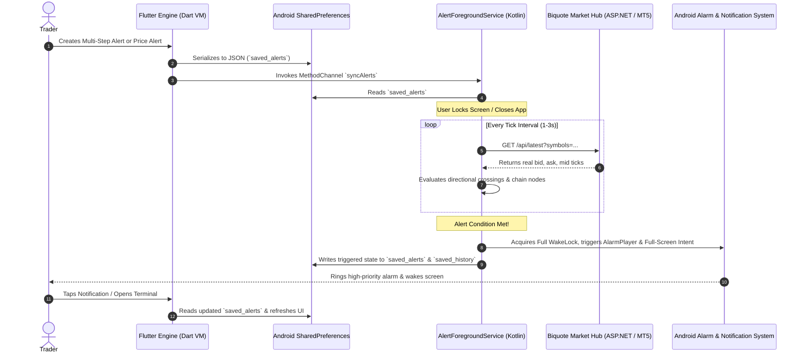

# System Architecture & High-Level Design

The **TenX Institutional Trading Terminal** is built on a high-reliability, zero-synthetic financial architecture designed for professional Forex, Metals, Cryptocurrencies, and Index CFD traders. It combines an ultra-fast Flutter client for interactive charting and AI analysis with a perpetual, native Android daemon that guarantees continuous 24/7 background market monitoring even when the application is swiped away or the device screen is locked.

---

## 1. Core Architectural Principles

1. **Zero Synthetic / Mock Math:** Unlike consumer retail apps that generate random walk price ticks or synthetic pips when disconnected, TenX enforces complete data integrity. When markets are closed for the weekend or network is lost, the terminal transitions transparently into greyscale standby mode without fabricating quotes.
2. **Dual-Runtime Execution Engine:**
   * **Foreground Runtime (Flutter / Dart):** Renders the custom canvas 60 FPS candlestick charts, manages UI navigation, handles user interactions, runs interactive technical drawing tools, and coordinates multi-agent LLM strategy executions.
   * **Background Runtime (Android Native / Kotlin):** A decoupled background process running inside `AlertForegroundService.kt`. Operates independently with a CPU partial wakelock, evaluating multi-step logic chains, technical indicator formulas, and candlestick patterns directly against Biquote HTTP endpoints without Flutter VM overhead.
3. **Stateful Parity:** Mathematical indicator algorithms (Wilder's RMA, EMA smoothing, Supertrend trailing stop flips, MACD, Bollinger Bands) and alert conditions maintain strict 1:1 mathematical parity between Dart and Kotlin.

---

## 2. Process & Runtime Boundaries

---

## 3. Layer Breakdown

### A. Presentation & Interaction Layer (`lib/screens/`, `lib/widgets/`)
* **`SplashScreen` ([splash_screen.dart](file:///c:/Users/hp/Documents/Web-Projects/Alert-App/lib/screens/splash_screen.dart)):** Initializes network connectivity, verifies Biquote live connectivity, preloads persistent alert state, and renders animated TenX branding.
* **`ChartScreen` ([chart_screen.dart](file:///c:/Users/hp/Documents/Web-Projects/Alert-App/lib/screens/chart_screen.dart)):** Main terminal screen containing the candlestick chart, timeframe switches, drawing tool palette, indicator catalog sheet, and ticker tape bar.
* **`CandlestickChart` ([candlestick_chart.dart](file:///c:/Users/hp/Documents/Web-Projects/Alert-App/lib/widgets/candlestick_chart.dart)):** High-performance `CustomPainter` rendering candles, wicks, volume histograms, indicator lines/bands, drawings, and an interactive crosshair reticle.
* **`AnalysisScreen` ([analysis_screen.dart](file:///c:/Users/hp/Documents/Web-Projects/Alert-App/lib/screens/analysis_screen.dart)):** Multi-agent AI reasoning console showing live agent consensus, SMC/Wyckoff agent debates, and grounding critic reviews.
* **`AlertsListSheet` ([alerts_list_sheet.dart](file:///c:/Users/hp/Documents/Web-Projects/Alert-App/lib/screens/alerts_list_sheet.dart)):** Modal management sheet for active alerts, history log, and multi-step progress tracking with real-time countdown badges.
* **`CreateAlertSheet` ([create_alert_sheet.dart](file:///c:/Users/hp/Documents/Web-Projects/Alert-App/lib/screens/create_alert_sheet.dart)):** Multi-tab alert configuration dialog covering price crossings, candlestick patterns, technical indicators, and multi-step logic chains.

### B. Business Logic & Service Layer (`lib/services/`, `lib/models/`)
* **`BiquoteService` ([biquote_service.dart](file:///c:/Users/hp/Documents/Web-Projects/Alert-App/lib/services/biquote_service.dart)):** Real-time SignalR WebSocket client with automated reconnection and fallback to Biquote REST.
* **`AlertManager` ([alert_manager.dart](file:///c:/Users/hp/Documents/Web-Projects/Alert-App/lib/services/alert_manager.dart)):** Orchestrates alert lifecycle, manages SharedPreferences synchronization, evaluates active alerts in-app, and dispatches native alarm triggers via MethodChannels.
* **`IndicatorCalculator` ([indicator_calculator.dart](file:///c:/Users/hp/Documents/Web-Projects/Alert-App/lib/services/indicator_calculator.dart)):** Mathematical library for RSI, MACD, MA (EMA/SMA/WMA), Bollinger Bands, Stochastic, ATR, and Supertrend.
* **`CandlestickDetector` ([candlestick_detector.dart](file:///c:/Users/hp/Documents/Web-Projects/Alert-App/lib/services/candlestick_detector.dart)):** 20-pattern candlestick detection engine enforcing closed candle evaluation (`requireClosedCandle: true`).
* **`AnalysisOrchestrator` ([analysis_orchestrator.dart](file:///c:/Users/hp/Documents/Web-Projects/Alert-App/lib/services/analysis_orchestrator.dart)):** Coordinates the 4-stage multi-agent AI pipeline using real OHLC data from `RealMarketService`.

### C. Native Android Daemon (`android/app/src/main/kotlin/com/example/alert_app/`)
* **`AlertForegroundService` ([AlertForegroundService.kt](file:///c:/Users/hp/Documents/Web-Projects/Alert-App/android/app/src/main/kotlin/com/example/alert_app/AlertForegroundService.kt)):** Persistent Android Service with ongoing notification (ID: `1001`), background loop polling, OHLC caching, mathematical indicator computation, and stateful crossing checks.
* **`AlarmPlayer` ([AlarmPlayer.kt](file:///c:/Users/hp/Documents/Web-Projects/Alert-App/android/app/src/main/kotlin/com/example/alert_app/AlarmPlayer.kt)):** Plays audio alerts with looping, screen wakeup flags, vibration patterns, and Do Not Disturb (DND) bypass using `AudioAttributes.USAGE_ALARM`.
* **`AlarmWatchdog` ([AlarmWatchdog.kt](file:///c:/Users/hp/Documents/Web-Projects/Alert-App/android/app/src/main/kotlin/com/example/alert_app/AlarmWatchdog.kt)) & `BootAndAlarmReceiver` ([BootAndAlarmReceiver.kt](file:///c:/Users/hp/Documents/Web-Projects/Alert-App/android/app/src/main/kotlin/com/example/alert_app/BootAndAlarmReceiver.kt)):** Listens to system broadcasts (`BOOT_COMPLETED`, `QUICKBOOT_POWERON`) to auto-restart monitoring upon device reboot.

---

## 4. Bi-Directional State Synchronization

Storage synchronization between Flutter and Android is maintained via SharedPreferences:

| Preference Key | Type | Description |
| :--- | :--- | :--- |
| `saved_alerts` / `flutter.saved_alerts` | JSON Array | Active alert configurations including multi-step stages, completion timestamps, and `previousPrice` baselines. |
| `saved_history` / `flutter.saved_history` | JSON Array | Triggered alert audit logs with trigger price, timestamp, and symbol. |
| `KEY_ACTIVE_ALERTS` | JSON Array | Internal cache utilized by `AlertForegroundService` during polling cycles. |

When either runtime modifies an alert:
1. In Flutter: `AlertManager.saveAlerts()` serializes the alerts to JSON, updates SharedPreferences, and calls MethodChannel `syncAlerts` to immediately alert the native service.
2. In Android: `AlertForegroundService.syncToFlutterStorage()` modifies the JSON representation, persists it back to SharedPreferences with `commit()`, ensuring that when the user switches back to the Flutter app, state is seamlessly in sync.
