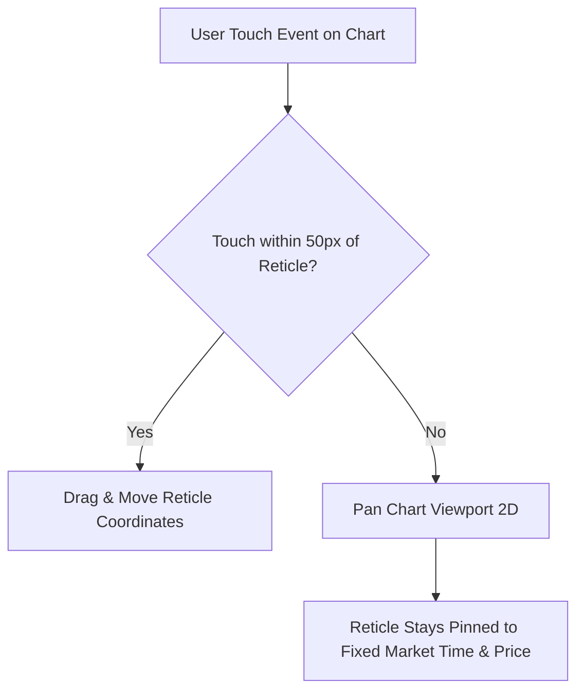

# Charting & Interactive Drawing Engine

The TenX charting engine provides high-fidelity, interactive technical analysis rendering directly on Flutter's hardware-accelerated canvas via `CustomPainter`. It delivers TradingView-class touch ergonomics, sub-pixel rendering precision, and drawing-attached alerting.

---

## 1. Coordinate Transformation System

The candlestick canvas maps non-linear financial time-series data into 2D screen coordinates:

$$\text{Canvas Width} = W, \quad \text{Canvas Height} = H$$
$$\text{Price Scale} = \frac{H - \text{padding}}{\text{MaxPrice} - \text{MinPrice}}$$

* **X Coordinate Mapping:** Determined by the visible candle index, the horizontal pan offset (`_panOffset`), and the dynamic candle width (`_candleWidth`):
  $$X_i = W - \text{PriceAxisWidth} - ((N - 1 - i) \times \text{CandleWidth}) + \text{PanOffset}$$
* **Y Coordinate Mapping:** Inverts financial price space to canvas space (where $Y=0$ is the top edge):
  $$Y(P) = ( \text{MaxPrice} - P ) \times \text{PriceScale} + \text{TopPadding}$$

---

## 2. Decoupled Crosshair Reticle Ergonomics

In standard mobile charting implementations, activating crosshair mode locks the screen and freezes viewport panning. TenX implements **TradingView-style decoupled touch ergonomics**:

### Implementation Details in [candlestick_chart.dart](file:///c:/Users/hp/Documents/Web-Projects/Alert-App/lib/widgets/candlestick_chart.dart#L350-L400)
1. **Reticle Dragging:** Touching within 50px of the crosshair reticle hub allows the user to drag and position the reticle over specific wicks and price levels.
2. **Viewport Panning:** Touching anywhere else on the chart scrolls the viewport horizontally and vertically. The crosshair remains locked to its stored market data coordinates (`timestamp` and `price`), accurately tracking across the screen as candles move beneath it.
3. **Single-Tap Repositioning:** Tapping any location on the canvas instantly moves the reticle to that exact candle and price level.

---

## 3. Technical Drawing Palette

TenX features an interactive drawing toolset accessible from the floating chart toolbar:

| Tool | Geometry | Key Applications |
| :--- | :--- | :--- |
| **Horizontal Line** | Constant $Y$ across full width | Key support and resistance levels, psychological numbers. |
| **Trendline** | Segment between $(P_1, T_1)$ and $(P_2, T_2)$ | Dynamic trend channels, ascending/descending wedges. |
| **Ray Line** | Origin $(P_1, T_1)$ extending infinitely through $(P_2, T_2)$ | Breakout projection, multi-session support lines. |
| **Fibonacci Retracement** | Horizontal levels at 0.0, 0.236, 0.382, 0.500, 0.618, 0.786, 1.0 | Harmonic pullbacks, golden pocket retracements. |
| **Rectangle** | Box spanning $[T_1, T_2] \times [P_1, P_2]$ | Order blocks, Fair Value Gaps, accumulation zones. |
| **Vertical Line** | Constant $X$ at specific timestamp $T$ | High-impact news releases, session opens (London/NY). |

### Interactive Handle Dragging & Alert Sync
* Drawings display circular drag handles on their anchor points.
* Tapping a drawing selects it, revealing an alert bell icon and a trash can delete icon.
* Moving Handle 1 or Handle 2 updates the underlying mathematical geometry in real-time. Upon releasing the handle (`onScaleEnd`), the updated price coordinate is emitted and automatically syncs any attached price alerts in `AlertManager`.

---

## 4. Multi-Pane Indicator Visualization

The chart engine supports layered technical indicators across two visual tiers:

### Tier 1: Main Chart Overlays
* **Dual Moving Averages:** Fast and Slow MAs rendered as smooth bezier curves over candle price action.
* **Bollinger Bands:** Translucent colored fill between the upper and lower bands with a solid middle basis line.
* **Supertrend:** Color-coded dynamic trailing stop (Green for active uptrend, Red for active downtrend) with markers on trend flips.

### Tier 2: Sub-Panel Oscillators
Indicators with independent scaling ranges render in dedicated sub-panels below the main price chart:
* **RSI Sub-Panel:** 0-100 bounded scale with dashed lines at overbought (70), oversold (30), and centerline (50).
* **MACD Sub-Panel:** MACD line, signal line, and color-coded positive/negative histogram bars centered on zero.
* **Stochastic Sub-Panel:** $\%K$ (solid line) and $\%D$ (dashed line) bounded between 0 and 100 with 20/80 threshold zones.
