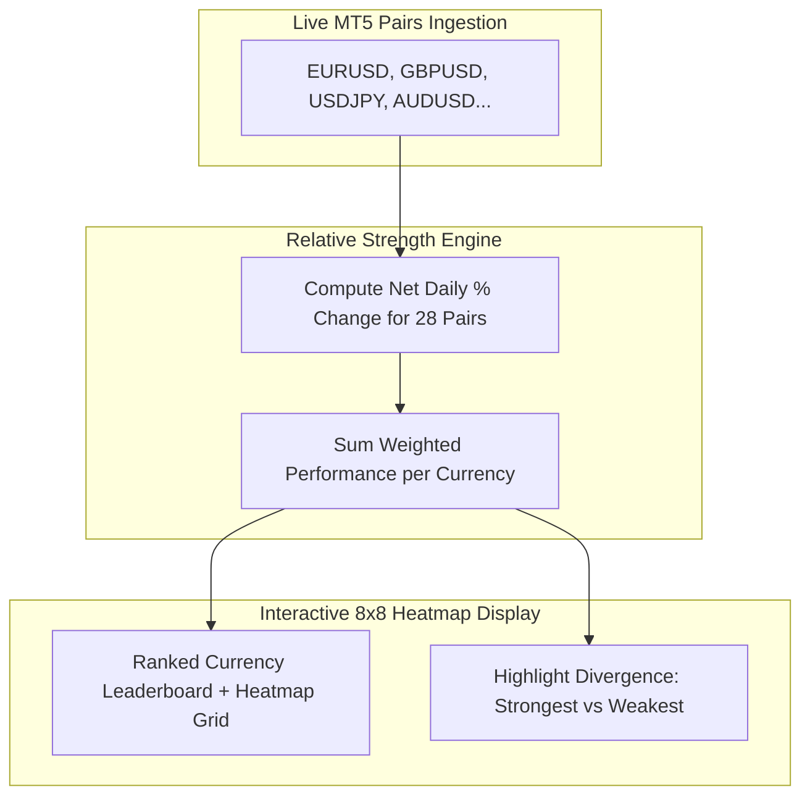

# Market Intelligence & Macroeconomic Tools

Beyond direct charting and alert tracking, TenX provides four integrated market intelligence tools designed to give operators deep macro and relative-strength situational awareness.

---

## 1. Currency Cross Matrix Heatmap

The **Currency Cross Matrix** ([currency_matrix_screen.dart](file:///c:/Users/hp/Documents/Web-Projects/Alert-App/lib/screens/currency_matrix_screen.dart)) is an interactive $8 \times 8$ relative strength matrix covering the G8 major currencies:
$$\text{Currencies} = \{ \text{EUR}, \text{USD}, \text{GBP}, \text{JPY}, \text{CHF}, \text{AUD}, \text{CAD}, \text{NZD} \}$$

### Relative Strength Math
For each currency $C_i$, the net strength score $S(C_i)$ is computed by aggregating performance against all 7 counterparts:
$$S(C_i) = \sum_{j \neq i} \Delta\%(C_i / C_j)$$
* **Green Cells:** Positive relative outperformance (Base currency gaining against Quote).
* **Red Cells:** Negative relative underperformance (Base currency losing against Quote).
* **Divergence Discovery:** Enables instant identification of high-probability cross pairs (e.g., pairing the strongest currency like GBP with the weakest like JPY).

---

## 2. High-Impact Economic Calendar

The **Economic Calendar** ([economic_calendar_screen.dart](file:///c:/Users/hp/Documents/Web-Projects/Alert-App/lib/screens/economic_calendar_screen.dart)) tracks major macroeconomic events (interest rate decisions, CPI inflation, Non-Farm Payrolls, GDP):
* **Impact Classification:** Color-coded badges for High (Red), Medium (Orange), and Low (Yellow) volatility risks.
* **Consensus Comparison:**
  * **Actual vs Forecast vs Previous:** Clear tabular representation.
  * **Surprise Highlight:** If Actual exceeds Forecast in a dollar-positive direction, metrics render with green accents; negative surprises render in red.
* **Currency Filtering:** Direct filter buttons to isolate USD, EUR, GBP, JPY, etc.
* **Pre-News Alert Attachment:** One-tap alert scheduling before high-impact releases.

---

## 3. Market Movers & Volatility Breakouts

The **Market Movers Screen** ([market_movers_screen.dart](file:///c:/Users/hp/Documents/Web-Projects/Alert-App/lib/screens/market_movers_screen.dart)) renders real-time performance leaderboards across Forex, Metals, Cryptos, and Indices:
* **Top Gainers:** Ranked by 24-hour percentage advance.
* **Top Losers:** Ranked by 24-hour percentage decline.
* **Volatility Breakouts:** Instruments experiencing sudden expansions in True Range relative to their 20-day historical mean.
* **Direct Navigation:** Tapping any row opens the corresponding live candlestick terminal and order flow display.

---

## 4. Real-Time Financial News Stream

The **Financial News Feed** ([financial_news_screen.dart](file:///c:/Users/hp/Documents/Web-Projects/Alert-App/lib/screens/financial_news_screen.dart)) delivers breaking macroeconomic updates:
* **Sentiment Tagging:** Automated sentiment flags (Bullish, Bearish, or Neutral).
* **Asset Tagging:** Filter by asset class (`Forex`, `Crypto`, `Commodities`, `Central Banks`).
* **Timestamp Precision:** Relative timestamps (`2m ago`, `15m ago`) with auto-refreshing polling.
