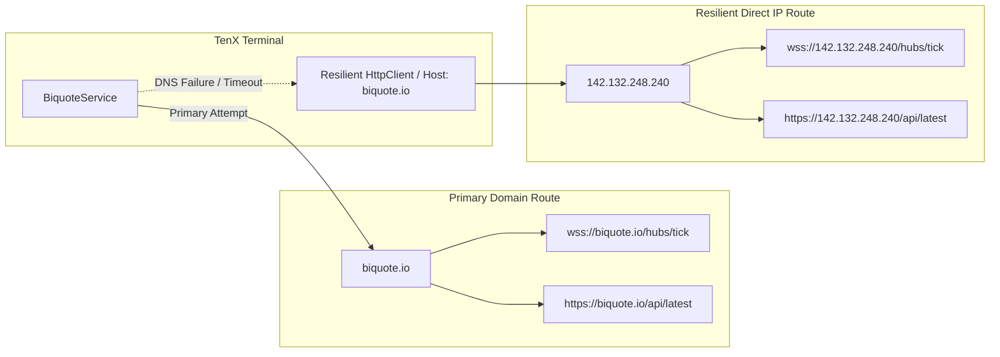

# Real-Time Market Streaming Engine

TenX connects directly to institutional MetaTrader 5 broker rates via **Biquote Real-Time Market Infrastructure** (`https://biquote.io`). This document details the SignalR WebSocket streaming layer, REST polling fallbacks, resilience engineering against DNS failures, and market state handling.

---

## 1. Streaming Infrastructure Overview

* **Primary Protocol:** ASP.NET Core SignalR WebSocket Hub over WSS (`wss://biquote.io/hubs/tick`).
* **Direct IP Fallback:** `wss://142.132.248.240/hubs/tick` with custom Host header injection.
* **REST Snapshot Endpoints:**
  * Quotes Snapshot: `https://biquote.io/api/latest?symbols={SYMBOLS}&allowStale=true`
  * Historical OHLC: `https://biquote.io/api/{SYMBOL}/ohlc?interval={INTERVAL}&limit={LIMIT}`



---

## 2. SignalR Protocol Specification

SignalR messages use JSON framing delimited by the Record Separator character (`\x1e`, Unicode `0x001E`).

### A. Handshake Protocol
Upon establishing the underlying WebSocket connection, TenX immediately sends the SignalR protocol handshake frame:
```json
{"protocol":"json","version":1}
```
The server responds with an empty handshake acknowledgment:
```json
{}
```

### B. Symbol Subscription Frame (`type: 1`)
To subscribe to real-time broker ticks for specific instruments:
```json
{
  "type": 1,
  "target": "Subscribe",
  "arguments": [
    ["EURUSD", "GBPUSD", "USDJPY", "XAUUSD", "BTCUSD"]
  ]
}
```

### C. Live Tick Broadcast Frame (`OnTick`)
Ticks received from the hub provide sub-second bid, ask, and mid prices:
```json
{
  "type": 1,
  "target": "OnTick",
  "arguments": [
    {
      "symbol": "EURUSD",
      "bid": 1.08542,
      "ask": 1.08554,
      "mid": 1.08548,
      "spread": 1.2,
      "timestamp": "2026-10-14T00:15:32.412Z",
      "isMarketOpen": true
    }
  ]
}
```

### D. Keep-Alive Ping (`type: 6`)
To maintain the persistent TCP connection through NAT gateways and mobile carrier proxies, TenX dispatches a periodic ping every 15 seconds:
```json
{"type":6}
```

---

## 3. Resilience Engineering: Direct IP Fallback

In mobile environments, Android emulators, and restrictive mobile ISP networks, DNS lookups for newly provisioned fintech domains may fail or be poisoned. TenX implements dual-route resilience:

1. **Route 1 (Standard):** Dispatches standard HTTPS/WSS requests to `biquote.io` with a strict 3-second timeout.
2. **Route 2 (Direct IP Bypass):** If Route 1 throws `SocketException` or times out, the engine executes an immediate fallback to `142.132.248.240`, injecting `Host: biquote.io` and configuring `badCertificateCallback = (cert, host, port) => true`.

Implementation in [biquote_service.dart](file:///c:/Users/hp/Documents/Web-Projects/Alert-App/lib/services/biquote_service.dart#L61-L88):
```dart
Future<dynamic> _fetchJson(String pathAndQuery) async {
  // 1. Try primary domain first
  try {
    final uri = Uri.parse('$baseUrl$pathAndQuery');
    final response = await _client.get(uri).timeout(const Duration(seconds: 3));
    if (response.statusCode == 200) return jsonDecode(response.body);
  } catch (_) {}

  // 2. Resilient Direct IP Fallback with Host header injection
  try {
    final uri = Uri.parse('$directBaseUrl$pathAndQuery');
    final req = await _ioClient.getUrl(uri).timeout(const Duration(seconds: 4));
    req.headers.set('Host', 'biquote.io');
    final resp = await req.close().timeout(const Duration(seconds: 4));
    if (resp.statusCode == 200) {
      final body = await resp.transform(utf8.decoder).join();
      return jsonDecode(body);
    }
  } catch (_) {}

  return null;
}
```

---

## 4. Symbol & Timeframe Normalization

TenX normalizes trading symbols and timeframe identifiers across third-party sources into institutional standards:

### Standard Symbol Map
| Display Name | Canonical Code | Category | Pip Multiplier |
| :--- | :--- | :--- | :--- |
| **EUR/USD** | `EURUSD` | Forex Major | 10,000 |
| **GBP/USD** | `GBPUSD` | Forex Major | 10,000 |
| **USD/JPY** | `USDJPY` | Forex Major | 100 |
| **USD/CHF** | `USDCHF` | Forex Major | 10,000 |
| **USD/CAD** | `USDCAD` | Forex Major | 10,000 |
| **AUD/USD** | `AUDUSD` | Forex Major | 10,000 |
| **NZD/USD** | `NZDUSD` | Forex Major | 10,000 |
| **GOLD / XAU/USD** | `XAUUSD` | Precious Metals | 10 |
| **SILVER / XAG/USD** | `XAGUSD` | Precious Metals | 100 |
| **OIL (WTI)** | `USOIL` | Commodities | 100 |
| **BTC/USD** | `BTCUSD` | Cryptocurrency | 1 |
| **ETH/USD** | `ETHUSD` | Cryptocurrency | 1 |
| **S&P 500** | `US500` | Index CFD | 1 |
| **NASDAQ** | `USTEC` | Index CFD | 1 |
| **DOW JONES** | `US30` | Index CFD | 1 |

### Timeframe Mapping
| Client Notation | Canonical Interval | MT5 Equivalent | Duration |
| :--- | :--- | :--- | :--- |
| `1m` / `1M` | `1m` | `M1` | 1 Minute |
| `5m` / `5M` | `5m` | `M5` | 5 Minutes |
| `15m` / `15M` | `15m` | `M15` | 15 Minutes |
| `30m` / `30M` | `30m` | `M30` | 30 Minutes |
| `1h` / `1H` | `1h` | `H1` | 1 Hour |
| `4h` / `4H` | `4h` | `H4` | 4 Hours |
| `1d` / `1D` | `1d` | `D1` | 1 Day |

---

## 5. Offline & Market Closed Handling

TenX rejects fabricated data:
* **Market Close State:** If `isMarketOpen == false` (e.g. Friday 22:00 UTC to Sunday 21:00 UTC for Forex), the UI displays a `Market Closed` status pill and retains the final verified close price.
* **Network Interruption:** If all connection attempts fail, `isOnlineNotifier.value` transitions to `false`. The chart and watchlists render in greyscale standby mode with a prominent "Network Disconnected — Tap to Reconnect" banner.
